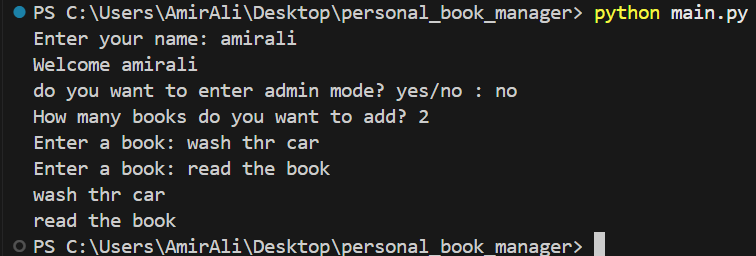

# Personal Book Manager


A simple book management project built with Python.

## Features

- Add multiple books
- Display books
- Save books
- Load saved books
- Admin Mode

## Requirements

- Python
- python-dotenv

## Installation

Install the required packages using:

```bash
python -m pip install -r requirements.txt
```

## Environment Setup

Create a `.env` file in the project folder.

The `.env.example` file is a template that shows which environment variable is needed.

The required variable is `BOOK_MANAGER_ADMIN_PASSWORD`.

Add this to your `.env` file:

```env
BOOK_MANAGER_ADMIN_PASSWORD=your_password_here
```

Replace `your_password_here` with your own password.

**Important:** Do not upload `.env` to GitHub. Only upload `.env.example`.

## Run the Program

The main file of the project is `main.py`.

Run the program using:

```bash
python main.py
```

## Screenshot

